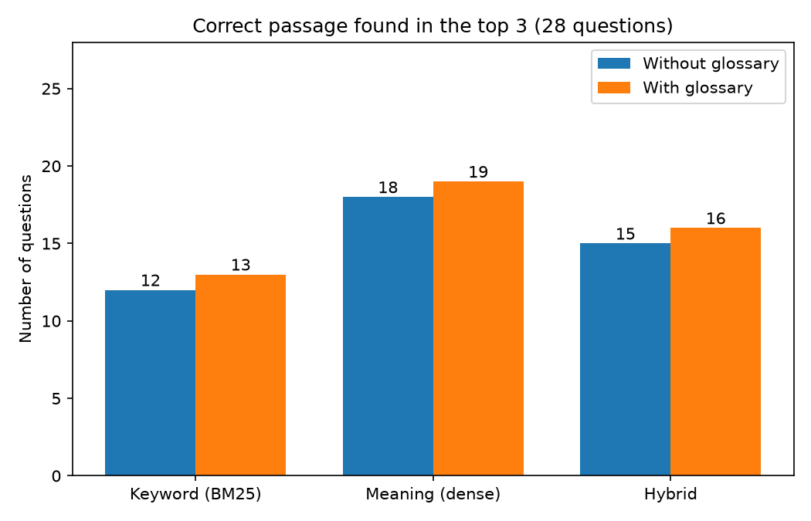

# Glossary query expansion: does it help?

Run 2026-10-27 on 125 chunks, the same 28 development questions as `retrieval_eval.md`. The glossary (`data/glossary.yaml`, 36 terms) was written from the papers by a fixed rule before this first run; it changed 13 of the 28 questions. The abbreviation question type was written after Gate 3 exposed BM25's abbreviation misses, so a gain here is a hypothesis to confirm in Phase 5, not a result.

| Method | Top-3 | Top-10 | MRR@10 | Top-3: own words | abbreviation | everyday words |
|---|---|---|---|---|---|---|
| bm25 | 43% | 61% | 0.450 | 73% | 30% | 14% |
| bm25 + glossary | 46% | 68% | 0.444 | 73% | 40% | 14% |
| dense | 64% | 82% | 0.577 | 55% | 60% | 86% |
| dense + glossary | 68% | 82% | 0.580 | 64% | 60% | 86% |
| hybrid | 54% | 79% | 0.487 | 73% | 40% | 43% |
| hybrid + glossary | 57% | 86% | 0.489 | 73% | 50% | 43% |

| MRR difference (glossary − plain) | Estimate | 95% interval |
|---|---|---|
| bm25 | -0.006 | [-0.065, +0.035] |
| dense | +0.003 | [+0.000, +0.009] |
| hybrid | +0.002 | [-0.045, +0.038] |

## Questions the glossary changed

| Question | Added | BM25 rank (before → after) |
|---|---|---|
| q03 (shared) | sequencing batch reactor sequential batch reactor sequencing biological reactor | 1 → 3 |
| q04 (abbreviation) | SRT | — → 6 |
| q05 (shared) | TN | 1 → 1 |
| q08 (abbreviation) | DO | — → — |
| q09 (abbreviation) | HRT | — → 5 |
| q11 (abbreviation) | RR | 1 → 1 |
| q12 (abbreviation) | TN | 5 → 3 |
| q13 (shared) | SBR | — → — |
| q14 (abbreviation) | DO | 5 → 5 |
| q19 (abbreviation) | SRT | 1 → 1 |
| q20 (shared) | EQ | 2 → 2 |
| q21 (shared) | OPEX | 1 → 1 |
| q22 (abbreviation) | BOD COD | 1 → 1 |
