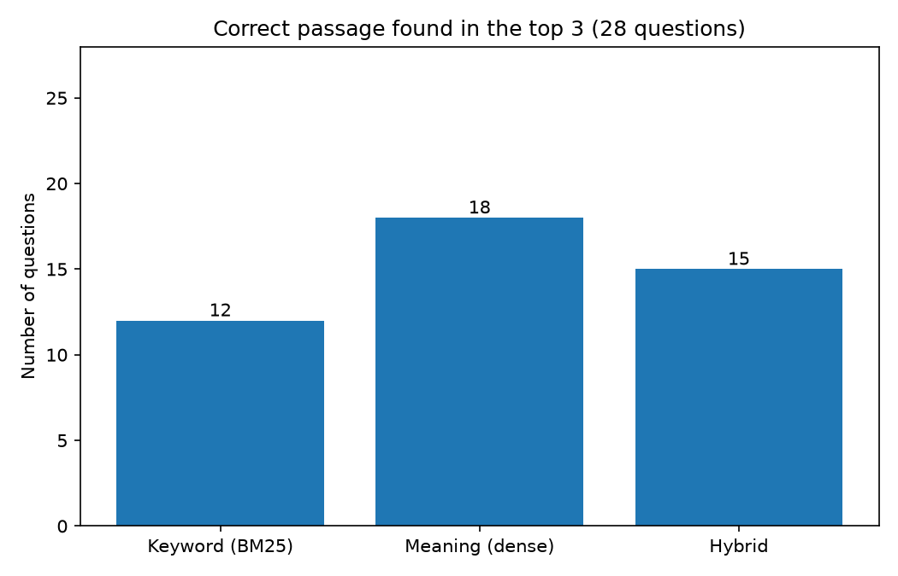
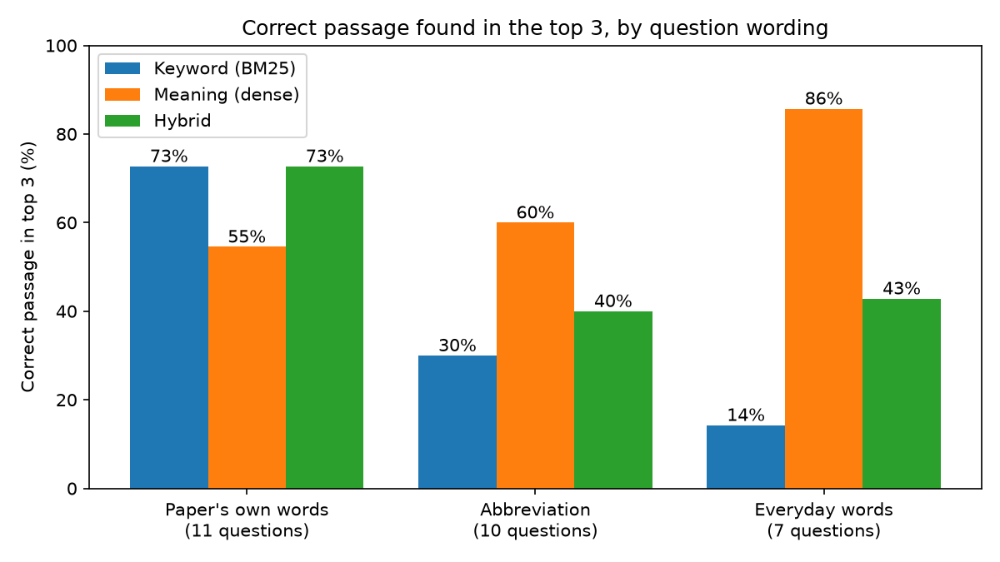

# Retrieval comparison: BM25 vs dense vs hybrid

Run 2026-10-13 on 125 chunks from 3 papers, 28 development questions (11 shared wording, 10 abbreviation, 7 paraphrase). Answer keys were fixed in `data/questions_dev.yaml` before the first run. The developer wrote both the system and the questions, so this guides decisions; it is not the independent Phase 5 evaluation.

| Method | Top-1 | Top-3 | Top-10 | MRR@10 | Median search time |
|---|---|---|---|---|---|
| bm25 | 39% | 43% | 61% | 0.450 | 0.4 ms |
| dense | 46% | 64% | 82% | 0.577 | 8.0 ms |
| hybrid | 39% | 54% | 79% | 0.487 | 8.2 ms |

| MRR difference | Estimate | 95% interval |
|---|---|---|
| Dense − BM25 | +0.127 | [-0.026, +0.285] |
| Hybrid − BM25 | +0.037 | [-0.043, +0.120] |
| Dense − Hybrid | +0.091 | [-0.011, +0.203] |

